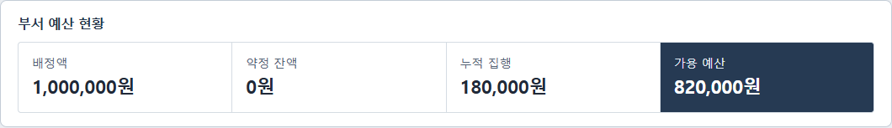

# 부서예산

은행·병원·일반 기업에서 직원이 교육비와 출장비를 신청하고, 부서장과 재무 담당자가 같은 신청번호로 승인·정산하는 웹 서비스입니다.

**[공개 데모 열기](https://129-225-133-96.sslip.io/)** · [3분 체험](#3분-체험) · [화면 기록](docs/EMPLOYEE-INBOX.md#공개-데모-화면-기록) · [설계와 검증](#설계와-검증)

개인 프로젝트 · 2026년 11월 · Oracle Cloud HTTPS 배포 
Java 21 · Spring Boot · MyBatis · Oracle · JSP/jQuery · React/TypeScript

## 핵심 문제 해결

- **정산 재시도의 멱등성** — 저장 직후 응답이 끊기면 같은 요청이 다시 들어올 수 있습니다. 신청 행을 잠근 뒤 같은 처리 차수의 정산이 끝났는지 확인합니다. 공개 데모에서 응답을 끊고 재전송해도 **정산 전표 1건, 집행액 180,000원**이 유지됐습니다. [정산 코드](src/main/java/kr/budget/claims/ClaimService.java#L270) · [공개 데모 시험 결과](docs/measurements/deployment-settlement-response-loss.json)
- **동시 승인 시 예산 초과 방지** — 두 결재가 같은 가용액을 사용할 수 있어, 부서 예산 행을 잠근 뒤 잔액을 다시 확인하고 약정을 기록합니다. 실제 Oracle에서 가용액 100,000원에 80,000원 승인 두 건을 겹친 **22회(예열 2회 포함)** 모두 **승인 1건, 거절 1건, 약정 전표 1건, 잔액 20,000원**을 확인했습니다. [동시 승인 원자료](docs/measurements/oracle-approval-contention-44807797272.json)
- **결재함의 깊은 페이지 조회** — OFFSET으로 건너뛸 행이 많아져 마지막 접수 순번으로 다음 구간을 찾는 키셋 조회를 적용했습니다. 실제 Oracle에 합성 신청 100만 건을 넣고, 한 부서의 9,000번째 이후 같은 51건을 조회했을 때 **논리 읽기 307회 → 13회**를 기록했습니다. [측정 조건과 실행 계획](docs/measurements/README.md#oracle-결재함-100만-건-측정)
- **재방문 시 CSS·JS 재전송** — 파일 해시를 URL에 넣어 내용이 바뀔 때 새 주소로 받도록 했습니다. 로컬 Chrome 5회 비교에서 CSS·JS·jQuery의 재방문 전송량은 **22,034B → 0B**였고 첫 방문 전송량은 **101B 증가**했습니다. [전후 측정](docs/measurements/README.md#정적-자산-재사용)
- **MySQL 포털의 중복 수신** — 같은 이벤트 ID의 기본 키에서 발생하는 레코드 잠금 대기를 확인하고, 재수신 시 기존 내용 해시로 일치 여부를 판정합니다. 실제 MySQL 8.4 시험 **3회** 모두 두 요청이 **HTTP 204**, 수신 이력과 요약이 **각 1건**이었습니다. 같은 ID의 금액을 바꿔 보내면 **HTTP 409**를 반환했습니다. [잠금 관측과 재현 절차](docs/MYSQL-CONCURRENT-RECEIPTS.md)
- **월마감 실패 후 재시작** — 결산표 저장이 실패한 기간은 마감 중으로 유지하고, 같은 부서·기간의 Spring Batch 작업을 재시작할 수 있게 했습니다. 실제 Oracle 시험에서 **배치 인스턴스 1개**에 실패와 성공 실행이 남았고, 복구 뒤 **집행액 45,000원**으로 마감됐습니다. [재시작 시험](src/test/java/kr/budget/claims/PostingContract.java#L555) · [Oracle 시험 결과](docs/measurements/oracle-cases-44809221277.json)
- **규정 변경 후 과거 계산 재현** — 신청 당시의 수식과 평가기 버전을 저장해 승인 결과의 근거를 보존합니다. 실제 Oracle에서 180,000원 학회비의 인정액을 **기존 신청 144,000원, 90% 규정 발행 후 신규 162,000원, 이전 규정 복구 후 신규 144,000원**으로 확인했습니다. [발행·복구 시험](src/test/java/kr/budget/claims/PostingContract.java#L607) · [Oracle 시험 결과](docs/measurements/oracle-cases-44809221277.json)
- **방문자·부서 사이의 증빙 접근 차단** — 증빙 조회 시 서버가 세션의 업무 공간과 신청번호를 함께 검사합니다. 공개 브라우저 시험에서 **다른 방문자**와 **같은 세션의 다른 부서**가 해당 신청의 증빙을 요청했을 때 모두 **HTTP 404**를 반환했습니다. [격리 시험](frontend/tests/claims.spec.ts#L54) · [공개 검증 기록](docs/PROGRESS.md#현재-상태)

## 3분 체험

**일반 기업 경영지원팀 → 내 신청함 시작**을 누르세요. 가입 없이 합성 데이터로 체험할 수 있습니다.

1. **직원** — 교육비 300,000원을 **신청 제출**합니다.
2. **부서장** — 같은 신청을 **사전승인**합니다. 승인 약정은 200,000원입니다.
3. **직원** — 실제 지출액 225,000원을 입력하고 **합성 증빙 첨부** 후 **정산 신청**을 누릅니다.
4. **재무 담당자** — **정산 확정** 후 **전표 조회**와 **결산표 조회**를 엽니다. 약정 잔액 **0원**, 집행액 **180,000원**, 가용 예산 **820,000원**을 확인할 수 있습니다.

공개 데모에서 처리한 합성 신청의 화면입니다. 데모 접속이 어려우면 [시작부터 정산까지의 화면 기록](docs/EMPLOYEE-INBOX.md#공개-데모-화면-기록)을 볼 수 있습니다.

## 설계와 검증

JSP·jQuery 결재함과 React·TypeScript 직원 신청함은 같은 Spring Boot API를 사용합니다. 서버가 세션의 역할과 부서를 확인하고 MyBatis를 통해 신청 상태와 전표를 Oracle에 기록합니다. 포털로 보낼 이벤트도 같은 트랜잭션에 저장합니다. PHP·MySQL 포털에 결과를 전달하고, 전송 장애가 나면 저장된 이벤트로 재시도합니다.

- [아키텍처·ERD와 핵심 소스](docs/ARCHITECTURE.md) · [신청번호로 API와 원장 대조](docs/API.md)
- [Oracle 통합 시험](docs/measurements/oracle-cases-44809221277.json) · [MySQL 동시 수신과 중복 처리 검증](docs/MYSQL-CONCURRENT-RECEIPTS.md)
- [Oracle 설치·복원](docs/ORACLE.md) · [HTTPS 배포·복구](docs/HTTPS.md)

로컬 실행과 테스트

Java 21, Maven, Node.js, Chrome을 준비하세요. `frontend`에서 `npm ci`와 `npm run build`를 실행합니다.

- **브라우저 체험과 시험** — `frontend`에서 `npx playwright test`를 실행합니다. 테스트 설정이 Tomcat과 임시 H2를 시작합니다.
- **실제 Oracle로 실행** — [Oracle 초기 설치](docs/ORACLE.md#최초-설치)를 마친 뒤 `BUDGET_DB_URL`, `BUDGET_DB_USER`, `BUDGET_DB_PASSWORD`를 환경 변수로 설정합니다. 저장소 루트에서 `mvn package`, `java -jar target/department-budget-0.1.0.war`를 실행합니다. 로컬 HTTP로 실행할 때는 `HTTPS_ONLY=false`를 설정합니다.

