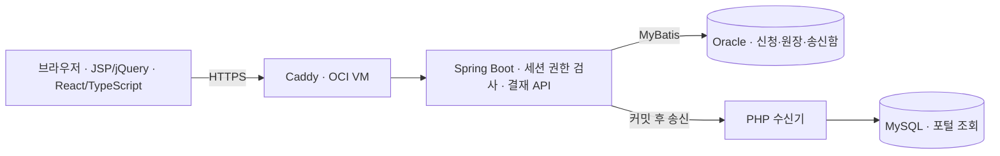

# 부서예산

직원이 교육비·출장비를 신청하면 부서장과 재무 담당자가 같은 신청번호로 승인·정산하고, 남은 예산을 확인하는 웹 서비스입니다.

**[공개 데모 열기](https://129-225-133-96.sslip.io/)** · [3분 체험](#3분-체험) · [화면 기록](docs/EMPLOYEE-INBOX.md#공개-데모-화면-기록) · [GitHub](https://github.com/kimdol/department-budget)

- **목적** — 신청서와 예산표를 따로 관리할 때 결재 상태와 실제 가용액을 대조하기 어려운 문제를 줄입니다. 은행·병원·일반 기업의 경비 흐름을 합성 데이터로 구현했습니다.
- **개인 프로젝트 · 2026년 11월 20~22일 본편 개발** — 신청·승인·정산 화면과 API, Oracle 원장, 포털 연계, HTTPS 배포·검증을 구현했습니다.
- **주요 기술** — Java 21 · Spring Boot · MyBatis · Oracle · JSP/jQuery · React/TypeScript · PHP/MySQL. Oracle Cloud에서 공개 데모를 운영합니다.

## 전체 시스템 구조



직원과 결재자의 화면은 같은 API를 사용합니다. 서버가 세션에서 역할과 부서를 확인하고, Oracle에 전표와 포털 송신 대기 행을 함께 저장합니다. 포털 전송을 분리해 장애 중에도 승인할 수 있고, 포털 조회는 재전송이 끝난 뒤 갱신됩니다. [역할별 처리 흐름과 ERD](docs/ARCHITECTURE.md)

## 핵심 성과

- **정산 중복 방지** — 공개 데모에서 커밋 직후 응답을 끊고 재전송해도 정산 전표는 **1건**, 집행액은 **180,000원**이었습니다. [재현과 코드](docs/TECHNICAL-CASES.md#정산-응답-유실과-중복-전표)
- **Oracle 결재함 조회** — 합성 신청 100만 건에서 같은 깊은 페이지 51행을 조회하며 논리 읽기를 **307회 → 13회**로 줄였습니다. [실행 계획과 표본](docs/TECHNICAL-CASES.md#oracle-결재함의-깊은-페이지)
- **React 신청함 상태 동기화** — 모듈이 늦게 로드될 때 접수 완료 안내와 빈 목록이 함께 뜨는 문제를 해결했습니다. 응답을 지연시킨 Chrome 시험에서 먼저 접수한 신청 **1건**을 표시했습니다. [재현과 회귀 시험](docs/TECHNICAL-CASES.md#react-신청함의-첫-렌더링)

## 3분 체험

**일반 기업 경영지원팀 → 내 신청함 시작**을 누릅니다. 가입 없이 합성 데이터로 체험할 수 있습니다.

1. **직원** — 교육비 300,000원을 **신청 제출**합니다.
2. **부서장** — 같은 신청을 **사전승인**합니다. 승인 약정은 200,000원입니다.
3. **직원** — 실제 지출액 225,000원을 입력하고 **합성 증빙 첨부** 후 **정산 신청**을 누릅니다.
4. **재무 담당자** — **정산 확정** 후 **전표 조회**와 **결산표 조회**를 엽니다. 약정 잔액 **0원**, 집행액 **180,000원**, 가용 예산 **820,000원**을 확인합니다.


공개 데모에서 처리한 합성 신청 화면입니다. 데모 접속이 어려우면 [시작부터 정산까지의 화면 기록](docs/EMPLOYEE-INBOX.md#공개-데모-화면-기록)을 볼 수 있습니다.

## 핵심 문제 해결

| 사례 | 적용한 설계 | 선택에 따른 비용·제약 |
| --- | --- | --- |
| [정산 응답 유실과 중복 전표](docs/TECHNICAL-CASES.md#정산-응답-유실과-중복-전표) | 신청·차수·상태를 잠금 안에서 검사 | 같은 부서의 회계 처리가 잠금 해제까지 대기합니다. |
| [동시 승인과 가용 예산](docs/TECHNICAL-CASES.md#동시-승인과-가용-예산) | 부서 예산 행 잠금 후 잔액 검사 | 서로 다른 신청도 같은 부서에서 승인하면 경합합니다. |
| [Oracle 결재함의 깊은 페이지](docs/TECHNICAL-CASES.md#oracle-결재함의-깊은-페이지) | 접수 순번으로 키셋 조회 | 이어보기에는 적합하며 임의의 페이지 번호로 바로 이동하기 어렵습니다. |
| [프론트엔드 정적 자산 캐시](docs/TECHNICAL-CASES.md#프론트엔드-정적-자산-캐시) | 파일 해시 URL과 장기 캐시 | 비교한 자산의 첫 방문 전송량이 101B 증가했습니다. |
| [React 신청함의 첫 렌더링](docs/TECHNICAL-CASES.md#react-신청함의-첫-렌더링) | 외부 상태 스냅샷과 변경 구독 | JSP와 React가 공통 상태의 갱신 규약을 지켜야 합니다. |
| [MySQL 포털의 중복 수신](docs/TECHNICAL-CASES.md#mysql-포털의-중복-수신) | 기본 키 제약, 내용 해시, 단일 트랜잭션 | 같은 이벤트는 레코드 잠금에서 대기하고 중복 경로는 해시를 다시 읽습니다. |
| [월마감 실패 후 재시작](docs/TECHNICAL-CASES.md#월마감-실패-후-재시작) | 부서·기간별 Spring Batch 인스턴스 재시작 | 배치 메타데이터를 관리하고 실패한 기간은 복구 전까지 마감 중으로 둡니다. |
| [규정 변경과 과거 계산 재현](docs/TECHNICAL-CASES.md#규정-변경과-과거-계산-재현) | 신청 당시 규정·평가기 버전 고정 | 규정 사본을 저장하고 이전 평가기와 회귀 시험을 유지합니다. |
| [방문자·부서 사이의 증빙 격리](docs/TECHNICAL-CASES.md#방문자부서-사이의-증빙-격리) | 세션의 부서 범위와 신청번호를 함께 검사 | 조회 경로마다 부서 범위를 적용하고 회귀 시험으로 확인해야 합니다. |

## 설계와 검증

- [요구사항·기술 선택과 트레이드오프](docs/ARCHITECTURE.md#프로젝트-배경과-요구사항) · [ERD](docs/ARCHITECTURE.md#핵심-테이블-관계) · [신청번호로 API와 원장 대조](docs/API.md)
- [보안·예외 처리와 테스트](docs/DEVELOPMENT.md#신뢰성보안예외-처리) · [측정 조건·전후 수치와 원자료](docs/measurements/README.md) · [브라우저 표시부터 SQL까지의 계측](docs/measurements/workspace-timing.md)
- [로컬 실행과 저장소 구조](docs/DEVELOPMENT.md#로컬-실행과-설치) · [배포·복구](docs/HTTPS.md) · [회고와 향후 개선](docs/DEVELOPMENT.md#회고와-향후-개선)

<details>
<summary>로컬 브라우저 시험</summary>

JDK 21, Maven, Node.js 22, Chrome을 준비합니다. 복제한 저장소 루트에서 아래 명령을 실행합니다. Playwright가 Tomcat과 임시 H2를 시작합니다. 실제 Oracle로 실행하려면 [Oracle 설치와 WAR 실행](docs/DEVELOPMENT.md#oracle-설치와-war-실행)을 따릅니다.

```sh
cd frontend
npm ci
npm run build
npx --no-install playwright test
```

</details>
