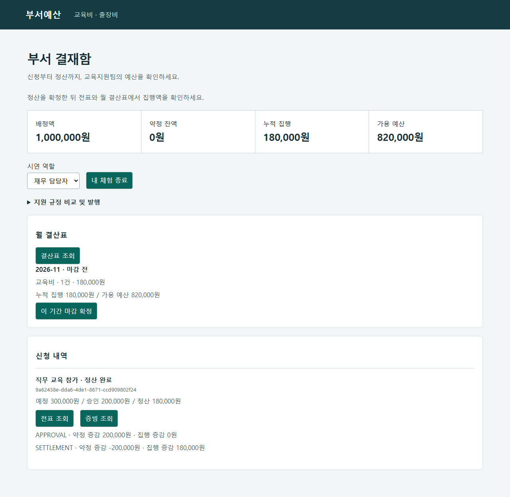

# 부서예산

은행 경영지원팀·병원 행정부서·일반 기업의 직원이 교육비와 출장비를 신청하고 부서장과 재무 담당자가 승인·정산하는 경영지원 웹 애플리케이션이다. 같은 신청번호로 **승인 금액과 실제 집행액의 차이**를 추적한다.

**공개 데모는 배포 준비 중이다.** [3분 체험 순서](#3분-체험)에서 직원의 300,000원 신청부터 부서장의 200,000원 약정, 재무의 180,000원 정산까지 따라갈 수 있다. 아래 화면은 로컬 Tomcat과 H2에서 Chrome으로 처리한 결과다. 같은 시점에 두 번째 방문자의 가용 예산은 1,000,000원이었다.

Java 21·Spring Boot·MyBatis·Oracle이 원장을 처리한다. JSP·jQuery는 신청·결재함, React·TypeScript는 직원 신청과 규정 비교·발행, PHP·MySQL은 사내 포털 수신에 사용한다. 직원 역할에서 **직원용 신청 화면으로 전환**을 누르면 입력한 내용을 React 화면에서 이어서 제출할 수 있다. [두 화면의 신청 계약 시험](frontend/tests/employee-form.spec.ts) · [화면에서 원장까지 소스 따라가기](#소스-따라가기)

## 직무별 구현 성과

| 업무 영역 | 구현과 검증 결과 |
| --- | --- |
| Java·Oracle 조회 최적화 | 합성 신청 100만 건을 100개 부서에 나눠 넣었다. 한 부서의 결재함에서 앞선 9,000건 이후 같은 51건을 조회할 때 Oracle 논리 읽기는 OFFSET 307회, 키셋 13회였다. 실행 순서를 교대한 4회 모두 같은 결과였다. [실행 계획 원자료](docs/measurements/oracle-inbox-44781386053.zip) |
| 금융·경영지원 SI/SM | Oracle 원장 시험 25건을 통과했다. 같은 본부 예산을 동시에 배정해도 잔액을 초과하지 않았고, 비목이 바뀐 신청은 원래 약정을 한 번만 해제했다. Data Pump로 같은 PDB의 별도 스키마에 복원한 뒤 신청 138건, 전표 44건, 원신청·재신청 연결을 포함해 원본과 복원 결과가 일치했다. [시험 결과](docs/measurements/oracle-contracts-44795805725.txt) · [복원 대사 원자료](docs/measurements/oracle-restore-44795805725.zip) |
| 웹 화면 성능 | 자체 JS·CSS의 내용 해시를 URL에 반영했다. 로컬 Chrome 결재함 재방문 때 정적 자산 3개의 전송량은 22,034B에서 0B로 줄었고, 첫 방문 전송량은 101B 증가했다. [전후 5회 측정](docs/measurements/README.md) |
| 병원 행정·규정 관리 | 학회비 지원율을 80%에서 90%로 바꾼 뒤에도 이전 신청의 인정액 144,000원을 재현했다. 같은 실비 180,000원의 신규 신청은 162,000원, 이전 규정 복구 후 접수한 신청은 144,000원이었다. [발행·복구 계약 시험](src/test/java/kr/budget/claims/PostingContract.java) |

## 3분 체험

혼자 학습비를 관리할 때는 첫 화면의 **내 자격시험·교육·도서 장부**를 연다. 개인 예산과 실제 지원받은 금액을 입력하면 본인 부담액을 기준으로 잔액을 보여준다. 다음 교육의 지원율·행사당 한도를 바꿔 지출 후 잔액도 예상할 수 있다. 데이터는 해당 브라우저 프로필에 보관되며, 사이트 데이터를 지우면 기록도 삭제된다. [개인 장부 시험](frontend/tests/personal-ledger.spec.ts)

개발자 도구를 열고 시연하면 같은 신청번호로 화면의 금액과 HTTP 응답을 대조할 수 있다. [역할별 요청·응답과 재시도](docs/API.md)

은행 경영지원팀·병원 행정부서·일반 기업 경영지원팀 중 한 곳을 선택하고 **개인 데모 시작**을 누른다. 병원 학회비 변경을 체험하려면 병원 행정부서를 선택한다. [학회비 규정 발행·복구 브라우저 시험](frontend/tests/hospital-policy.spec.ts)

**체험 부서**를 바꾸면 같은 조직의 다른 부서에서 별도 예산 1,000,000원으로 시작한다. 아래 순서를 진행할 때는 한 부서에서 역할만 바꾼다. 두 탭을 열어 서로 다른 부서를 선택하면 독립된 신청 목록과 약정 잔액을 비교할 수 있다.

지점 예산 배정은 새 은행 데모에서 체험한다. 본부의 재무 담당자로 전환해 지점에 300,000원을 배정하면 본부 가용액은 700,000원, 지점 가용액은 1,300,000원이 된다. 체험 부서를 지점으로 바꾸면 배정받은 금액으로 업무를 시작할 수 있다. [브라우저 시험](frontend/tests/bank-allocation.spec.ts)

| 역할 | 동작 | 원장 기준 결과 |
| --- | --- | --- |
| 직원 | 독립 데모를 시작하고 교육비 300,000원을 신청한다. | 배정 1,000,000원 |
| 부서장 | 지원율 80%, 한도 200,000원을 적용해 승인한다. | 약정 200,000원 |
| 직원 | 실제 지출 225,000원에 맞는 합성 영수증을 첨부하고 정산을 신청한다. 병원 학회비에는 참석 확인서도 첨부한다. | 재무 검토 대기 |
| 재무 담당자 | 정산을 확정한다. | 약정 0원 · 집행 180,000원 · 가용 820,000원 |

재무 담당자로 **전표 조회**와 **결산표 조회**를 열면 같은 신청의 약정 해제, 실제 집행액, 부서 가용액을 대조할 수 있다. [Chrome 회귀 시험](frontend/tests/claims.spec.ts)

## 브라우저 시험

CI에서는 실제 Oracle 원장과 송신함, HTTPS를 경유한 PHP 수신기, MySQL 수신 요약을 한 신청번호로 대조했다. Chrome에서 교육비 정산을 확정한 뒤 포털의 2차 수신액을 조회하고, 두 DB에서 같은 업무 공간·신청번호·차수·종류·금액(180,000원)을 확인했다. [실행 결과](https://github.com/kimdol/department-budget/actions/runs/44774362675/job/136420076607) · [재현 스크립트](ops/ci_https_proxy.sh)

원장과 실제 MySQL 포털 수신액을 한 화면에서 대조하려면 아래 HTTPS·포털 시험의 도구를 설치한 뒤 저장소 루트에서 `python ops/test_portal.py --browser`를 실행한다. 시험용 인증서를 신뢰하는 Java 송신기가 PHP로 정산을 전달하고 Chrome이 포털의 2차 수신액 180,000원을 읽는다. 이 로컬 시연에서 Java 업무 DB는 H2다.

로컬 HTTPS 재현은 프런트엔드 빌드 후 저장소 루트에서 `python ops/test_https.py`로 실행한다. Java 21·Maven·Chrome·Node.js·OpenSSL이 필요하다. 시험 도구는 하루짜리 인증서를 임시 생성하고 루프백 Tomcat에 연결한다. 쿠키 값과 비밀 키는 원자료에 저장하지 않는다. [TLS 및 캐시 실제 응답](docs/measurements/loopback-https.json)

포털 수신 시험은 PHP 8.1 이상과 PDO MySQL 확장, MySQL 8.4의 mysql·mysqld를 PATH에 둔 뒤 저장소 루트에서 `python ops/test_portal.py`로 실행한다. 별도 임시 데이터 디렉터리와 루프백 포트를 사용하며 시험 종료 시 서버를 닫는다. 승인과 정산을 각각 두 번 보내 실제 수신 이력 2건과 정산액 180,000원을 확인했다. [수신 시험 원자료](docs/measurements/portal-receipts.json)

Chrome, Java 21, Maven과 Node.js가 설치된 환경에서 `frontend` 디렉터리의 `npm ci`, `npm run build`, `npx playwright test`를 차례로 실행한다. 시험은 루프백 주소에서 전용 메모리 DB와 Tomcat을 시작한다.

## 실행과 검증

배포용 WAR에서 추출한 설치 SQL을 빈 Oracle 스키마에 적용했다. 같은 SQL을 다시 실행하면 ORA-20001로 중단되는 것을 확인했다. [설치 시험](https://github.com/kimdol/department-budget/actions/runs/44765732583) · [신청 한 건으로 Oracle 직접 실습](docs/ORACLE-WALKTHROUGH.md)

Java 21과 Maven을 사용한다. `mvn test`는 계산 규칙과 로컬 H2 계약 시험을 실행한다. 실제 Oracle 통합 시험은 **비어 있는 전용 시험 스키마**를 준비하고 `BUDGET_TEST_EMPTY_SCHEMA=yes`, `BUDGET_DB_URL`, `BUDGET_DB_USER`, `BUDGET_DB_PASSWORD`를 환경 변수로 설정한 뒤 같은 명령으로 실행한다. 이 모드는 시험 시작 시 스키마를 생성한다.

frontend 디렉터리에서 npm ci와 npm run build를 실행한다. 저장소 루트로 돌아와 애플리케이션 DB 접속 환경 변수를 설정하고 `mvn package`, `java -jar target/department-budget-0.1.0.war`를 실행한다. 최초 기동 전에 같은 WAR에서 업무 테이블과 배치 메타데이터를 추출해 설치한다. [Oracle 설치·마이그레이션·백업 및 복원](docs/ORACLE.md)을 참조한다. 로컬 HTTP 시험에 한해 `HTTPS_ONLY=false`를 지정한다. 공개 배포와 실측 성능은 [검증 현황](docs/PROGRESS.md)에서 확인할 수 있다.

## 소스 따라가기

[아키텍처·ERD와 업무별 소스 안내](docs/ARCHITECTURE.md)에서 신청 한 건의 전표와 병원 학회비 규칙 변경을 파일·메서드별로 따라갈 수 있다.

1. [결재함](src/main/webapp/WEB-INF/views/portal.jsp)에서 제출하면 [화면 요청 코드](src/main/resources/static/assets/portal.js)가 요청 키를 보존한다.
2. [DemoPortal](src/main/java/kr/budget/web/DemoPortal.java)은 세션에서 방문자 공간과 역할을 결정한다.
3. [ClaimService](src/main/java/kr/budget/claims/ClaimService.java)는 신청 재전송을 판별하고 승인·정산 단계에서 잠금, 상태 변경, 전표, 잔액을 한 트랜잭션으로 처리한다.
4. [BudgetMapper](src/main/java/kr/budget/claims/BudgetMapper.java)의 바인딩 SQL이 같은 공간의 신청과 전표를 연결한다. [원장 계약 시험](src/test/java/kr/budget/claims/PostingContract.java)은 중복 요청·재시도와 경합 후 금액을 검사한다.
5. [지원액 계산기](src/main/java/kr/budget/policy/ExpenseFormula.java)의 입력은 원 단위 금액·지원율·한도·일수다. [비교 사례](src/test/java/kr/budget/policy/ExpenseFormulaTest.java)에서 학회비 후보 수식만 바꾸고 일반 교육비의 기존 결과를 대조한다. [규정 편집기](frontend/src/policy.tsx)에서 학회 참가비를 선택하고 재무 담당자로 검토 요청, 부서장으로 발행한다. [PolicyService](src/main/java/kr/budget/policy/PolicyService.java)에서 기존 규정의 세대와 비교한다. 원래 수식 복구도 같은 절차를 거친다.
