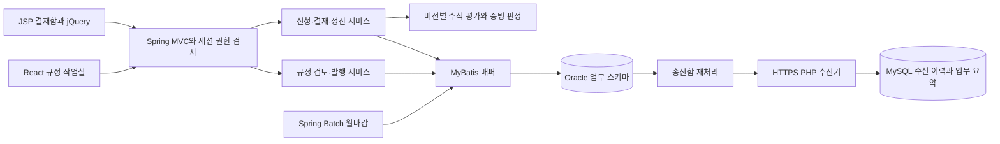
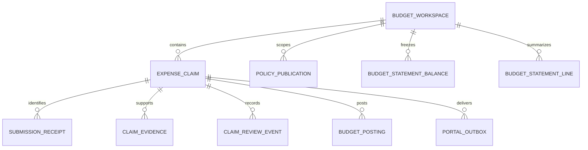

# 신청 한 건의 처리 경로

방문자 공간과 시연 역할은 서버 세션에서 결정한다. Oracle에 저장할 업무 전표와 포털 송신 대기 행은 한 트랜잭션에서 기록한다. 원격 수신은 나중에 실행하므로 포털 장애가 난 동안에도 이미 승인된 신청의 약정은 보존된다. [업무 트랜잭션](../src/main/java/kr/budget/claims/ClaimService.java) · [송신 재처리](../src/main/java/kr/budget/portal/PortalRelay.java) · [수신 이력 기록](../portal/receive.php)

## 역할별 업무 권한

| 업무 | 직원 | 부서장 | 재무 담당자 | 처리 조건 |
| --- | --- | --- | --- | --- |
| 비용 신청·철회, 실비 제출, 증빙 첨부 | 허용 | — | — | 해당 부서와 신청 상태, 정산 차수를 검사한다. |
| 사전승인·증액 승인 | — | 허용 | 최종 사전승인 | 재무 사전승인은 부서장이 재무로 넘긴 결재 경로에서 수행한다. |
| 보완 요청 | — | 증액 검토 중 | 정산 검토 중 | 현재 차수와 사유가 필요하다. |
| 정산 확정, 전표 조회, 월마감·환입, 포털 재전송 | — | — | 허용 | 정산 확정 전에는 신청에 저장된 규정으로 증빙 요건을 검사한다. |
| 규정 후보 검토 요청·발행 | — | 발행·예약 | 후보 제출 | 발행은 검토한 해시와 세대가 일치할 때 처리한다. |
| 은행 지점 예산 배정 | — | — | 본부 재무 | 같은 조직의 본부에서 소속 지점으로 배정한다. |
| 신청 이력·버전·증빙 조회 | 허용 | 허용 | 허용 | 현재 방문자의 선택 부서에서 신청번호를 찾는다. |

시연에서 직원이 부서장을 대행해도 신청자 식별자는 그대로다. 자기 신청의 사전승인·증액 및 보완 처리는 서버에서 거절한다. 규정 발행은 정식 부서장 역할을 요구한다. 역할 전환은 각 방문자의 합성 부서에만 적용된다. [HTTP 인가](../src/main/java/kr/budget/web/DemoPortal.java) · [자기 결재 검사](../src/main/java/kr/budget/claims/ClaimService.java) · [역할 전환 시험](../frontend/tests/employee-form.spec.ts) · [증빙 격리 시험](../frontend/tests/claims.spec.ts)

## 교육비 300,000원

| 추적 단계 | 읽을 곳 | 같은 신청번호에서 확인할 값 |
| --- | --- | --- |
| 신청 버튼 | [JSP](../src/main/webapp/WEB-INF/views/portal.jsp), [제출 이벤트](https://github.com/kimdol/department-budget/blob/65e12691c4576bfc32bab924a784c241a0bdb6a4/src/main/resources/static/assets/portal.js#L490) | 화면이 요청 키를 보관한다. 서버가 만든 신청번호를 응답으로 받는다. |
| 신청 접수 | [DemoPortal.submit](https://github.com/kimdol/department-budget/blob/65e12691c4576bfc32bab924a784c241a0bdb6a4/src/main/java/kr/budget/web/DemoPortal.java#L117), [ClaimService](../src/main/java/kr/budget/claims/ClaimService.java) | 비목·예정액·일수·수식·발행 세대·평가기·결재 경로를 고정한다. 이 시점의 약정은 0원이다. |
| 부서장 승인 | [commitApproval](https://github.com/kimdol/department-budget/blob/65e12691c4576bfc32bab924a784c241a0bdb6a4/src/main/java/kr/budget/claims/ClaimService.java#L198), [전표 INSERT](https://github.com/kimdol/department-budget/blob/65e12691c4576bfc32bab924a784c241a0bdb6a4/src/main/java/kr/budget/claims/BudgetMapper.java#L136) | 예산 행과 신청을 잠그고 가용액을 검사한다. APPROVAL의 약정 증감은 +200,000원이다. |
| 실비 정산 | [settle](https://github.com/kimdol/department-budget/blob/65e12691c4576bfc32bab924a784c241a0bdb6a4/src/main/java/kr/budget/claims/ClaimService.java#L261), [증빙 판정](../src/main/java/kr/budget/claims/EvidencePolicy.java) | 영수증과 실비 225,000원을 대조한다. SETTLEMENT의 약정 증감은 −200,000원, 집행 증감은 +180,000원이다. |
| 원장 대사 | [결산 SQL](../src/main/java/kr/budget/closing/ClosingMapper.java), [정산 브라우저 시험](../frontend/tests/claims.spec.ts) | 배정 1,000,000원에서 약정 잔액 0원과 누적 집행 180,000원을 차감하면 가용액은 820,000원이다. |

## 포털 장애 중 승인 처리

포털이 중단돼도 부서장은 교육비를 승인할 수 있다. 약정과 송신함이 함께 커밋된 뒤 HTTP 전송이 시작된다. 전송 실패 시 재무 담당자는 **포털 송신 실패 조회**에서 자기 업무 공간의 신청번호, 시도 횟수, 수신 HTTP 상태나 연결 오류를 읽을 수 있다. 자동 재시도는 계속된다. 복구를 확인한 담당자가 **다시 보내기**를 누르면 같은 이벤트 식별자와 금액을 사용한다. 앞선 차수가 수신 확인을 받기 전에는 다음 차수를 보낼 수 없다.

응답이 유실되면 원격 수신이 먼저 성공했을 수도 있다. PHP 수신기는 같은 이벤트의 내용 해시를 검사하고 같은 메시지에 204를 반환한다. Java는 이 응답을 받은 뒤 송신 완료를 기록한다. 수신 실패 화면의 금액은 송신할 메시지의 원래 금액이다. 원장 잔액과 수신측 최종 금액은 원신청의 전표 조회와 사내 포털 수신 결과로 각각 확인한다. [송신함 SQL](../src/main/java/kr/budget/portal/PortalOutbox.java) · [PHP 수신 트랜잭션](../portal/receive.php) · [장애 복구 브라우저 시험](../frontend/tests/portal-retry.spec.ts)

## 핵심 테이블 관계

업무 공간의 키는 workspace_id, 신청 키는 claim_id다. 증빙·전표의 복합 외래 키는 공간과 신청의 조합을 검사한다. 전표의 기본 키는 신청번호와 전표 종류다. 정정 전표는 원래 정산 전표를 참조한다. 월마감 잔액과 비목별 집계는 공간·기간으로 조회한다. [버전별 스키마](../src/main/resources/db)

## 병원 학회비 규칙을 바꾸려면

병원 행정부서로 시작해 재무 담당자로 학회 참가비를 선택하고 인정액 수식에 `min(eligible_cost * 0.90, event_cap)`을 입력한다. 실비 180,000원에서 기존 144,000원과 후보 162,000원을 대조하고 검토를 요청한다. 부서장으로 바꿔 발행하면 이후 접수하는 학회 신청에 적용된다. 이전 수식을 복구하면 새 발행 세대가 생긴다. [규정 작업실](../frontend/src/policy.tsx) · [후보 저장](https://github.com/kimdol/department-budget/blob/65e12691c4576bfc32bab924a784c241a0bdb6a4/src/main/java/kr/budget/policy/PolicyService.java#L92) · [발행](https://github.com/kimdol/department-budget/blob/65e12691c4576bfc32bab924a784c241a0bdb6a4/src/main/java/kr/budget/policy/PolicyService.java#L117)

이 변경에는 컨트롤러나 전표 SQL 수정이 필요하지 않다. 제출 시 복사한 수식과 평가기 식별자로 과거 신청을 계산하기 때문이다. 은행 학회비·병원 일반 교육비가 그대로인지와 복구 후에도 이전 우대 신청이 162,000원인지 검증한다. [원장 계약 시험](https://github.com/kimdol/department-budget/blob/65e12691c4576bfc32bab924a784c241a0bdb6a4/src/test/java/kr/budget/claims/PostingContract.java#L543) · [발행·복구 화면 시험](../frontend/tests/hospital-policy.spec.ts)
