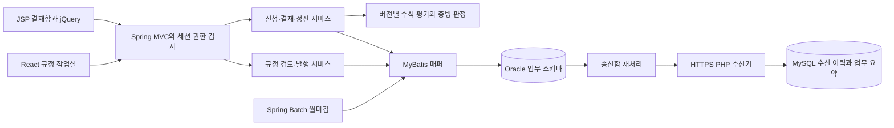
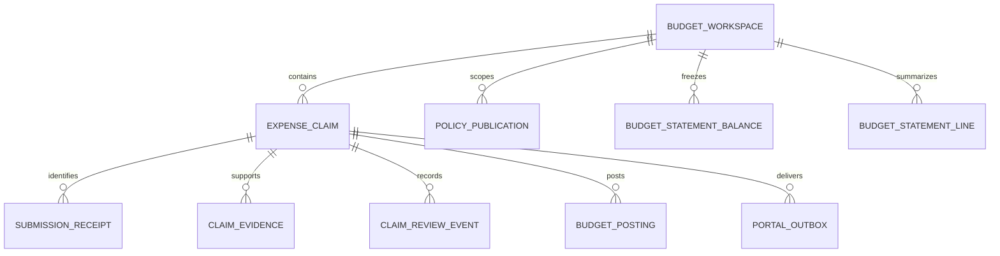

# 신청 한 건의 처리 경로

방문자 공간과 시연 역할은 서버 세션에서 결정합니다. Oracle에 저장할 업무 전표와 포털 송신 대기 행은 한 트랜잭션에서 기록합니다. 원격 수신은 나중에 실행하므로 포털 장애가 난 동안에도 이미 승인된 신청의 약정은 보존됩니다. [업무 트랜잭션](../src/main/java/kr/budget/claims/ClaimService.java) · [송신 재처리](../src/main/java/kr/budget/portal/PortalRelay.java) · [수신 이력 기록](../portal/receive.php)

결재함은 JSP와 jQuery로 신청 목록을 그리고, 선택한 신청 아래에 계산 근거·증빙·결재 이력을 엽니다. 목록에서 필터와 페이지를 유지하고, 결재·보완 후에는 같은 신청 제목으로 키보드 포커스를 돌려줍니다. 이 화면의 설계 변경으로 jqGrid 연동은 적용 범위에서 빠졌습니다. 상태 필터·상세 왕복·키보드 동작은 공개 HTTPS에서 검증했습니다. [목록 필터 시험](../frontend/tests/inbox-pages.spec.ts) · [키보드 결재 시험](../frontend/tests/keyboard-review.spec.ts)

## 역할별 업무 권한

| 업무 | 직원 | 부서장 | 재무 담당자 | 처리 조건 |
| --- | --- | --- | --- | --- |
| 비용 신청·철회, 실비 제출, 증빙 첨부 | 허용 | — | — | 해당 부서와 신청 상태, 정산 차수를 검사합니다. |
| 사전승인·증액 승인 | — | 허용 | 최종 사전승인 | 재무 사전승인은 부서장이 재무로 넘긴 결재 경로에서 수행합니다. |
| 보완 요청 | — | 증액 검토 중 | 정산 검토 중 | 현재 차수와 사유가 필요합니다. |
| 정산 확정, 전표 조회, 월마감·환입, 포털 재전송 | — | — | 허용 | 정산 확정 전에는 신청에 저장된 규정으로 증빙 요건을 검사합니다. |
| 규정 후보 검토 요청·발행 | — | 발행·예약 | 후보 제출 | 발행은 검토한 해시와 세대가 일치할 때 처리합니다. |
| 은행 지점 예산 배정 | — | — | 본부 재무 | 같은 조직의 본부에서 소속 지점으로 배정합니다. |
| 신청 이력·버전·증빙 조회 | 허용 | 허용 | 허용 | 현재 방문자의 선택 부서에서 신청번호를 찾습니다. |

시연에서 직원이 부서장을 대행해도 신청자 식별자는 그대로입니다. 자기 신청의 사전승인·증액 및 보완 처리는 서버에서 거절합니다. 규정 발행은 정식 부서장 역할을 요구합니다. 역할 전환은 각 방문자의 합성 부서에만 적용됩니다. [HTTP 인가](../src/main/java/kr/budget/web/DemoPortal.java) · [자기 결재 검사](../src/main/java/kr/budget/claims/ClaimService.java) · [역할 전환 시험](../frontend/tests/employee-form.spec.ts) · [증빙 격리 시험](../frontend/tests/claims.spec.ts)

## 교육비 300,000원

| 추적 단계 | 읽을 곳 | 같은 신청번호에서 확인할 값 |
| --- | --- | --- |
| 신청 버튼 | [JSP](../src/main/webapp/WEB-INF/views/portal.jsp), [제출 이벤트](https://github.com/kimdol/department-budget/blob/65e12691c4576bfc32bab924a784c241a0bdb6a4/src/main/resources/static/assets/portal.js#L490) | 화면이 요청 키를 보관합니다. 서버가 만든 신청번호를 응답으로 받습니다. |
| 신청 접수 | [DemoPortal.submit](https://github.com/kimdol/department-budget/blob/65e12691c4576bfc32bab924a784c241a0bdb6a4/src/main/java/kr/budget/web/DemoPortal.java#L117), [ClaimService](../src/main/java/kr/budget/claims/ClaimService.java) | 비목·예정액·일수·수식·발행 세대·평가기·결재 경로를 고정합니다. 이 시점의 약정은 0원입니다. |
| 부서장 승인 | [commitApproval](https://github.com/kimdol/department-budget/blob/65e12691c4576bfc32bab924a784c241a0bdb6a4/src/main/java/kr/budget/claims/ClaimService.java#L198), [전표 INSERT](https://github.com/kimdol/department-budget/blob/65e12691c4576bfc32bab924a784c241a0bdb6a4/src/main/java/kr/budget/claims/BudgetMapper.java#L136) | 예산 행과 신청을 잠그고 가용액을 검사합니다. APPROVAL의 약정 증감은 +200,000원입니다. |
| 실비 정산 | [settle](https://github.com/kimdol/department-budget/blob/65e12691c4576bfc32bab924a784c241a0bdb6a4/src/main/java/kr/budget/claims/ClaimService.java#L261), [증빙 판정](../src/main/java/kr/budget/claims/EvidencePolicy.java) | 영수증과 실비 225,000원을 대조합니다. SETTLEMENT의 약정 증감은 −200,000원, 집행 증감은 +180,000원입니다. |
| 원장 대사 | [결산 SQL](../src/main/java/kr/budget/closing/ClosingMapper.java), [정산 브라우저 시험](../frontend/tests/claims.spec.ts) | 배정 1,000,000원에서 약정 잔액 0원과 누적 집행 180,000원을 차감하면 가용액은 820,000원입니다. |

## 포털 장애 중 승인 처리

포털이 중단돼도 부서장은 교육비를 승인할 수 있습니다. 약정과 송신함이 함께 커밋된 뒤 HTTP 전송이 시작됩니다. 전송 실패 시 재무 담당자는 **포털 송신 실패 조회**에서 자기 업무 공간의 신청번호, 시도 횟수, 수신 HTTP 상태나 연결 오류를 읽을 수 있습니다. 자동 재시도는 계속됩니다. 복구를 확인한 담당자가 **다시 보내기**를 누르면 같은 이벤트 식별자와 금액을 사용합니다. 앞선 차수가 수신 확인을 받기 전에는 다음 차수를 보낼 수 없습니다.

응답이 유실되면 원격 수신이 먼저 성공했을 수도 있습니다. PHP 수신기는 같은 이벤트의 내용 해시를 검사하고 같은 메시지에 204를 반환합니다. Java는 이 응답을 받은 뒤 송신 완료를 기록합니다. 수신 실패 화면의 금액은 송신할 메시지의 원래 금액입니다. 원장 잔액과 수신측 최종 금액은 원신청의 전표 조회와 사내 포털 수신 결과로 각각 확인합니다. [송신함 SQL](../src/main/java/kr/budget/portal/PortalOutbox.java) · [PHP 수신 트랜잭션](../portal/receive.php) · [장애 복구 브라우저 시험](../frontend/tests/portal-retry.spec.ts)

## 핵심 테이블 관계

업무 공간의 키는 workspace_id, 신청 키는 claim_id다. 증빙·전표의 복합 외래 키는 공간과 신청의 조합을 검사합니다. 전표의 기본 키는 신청번호와 전표 종류입니다. 정정 전표는 원래 정산 전표를 참조합니다. 월마감 잔액과 비목별 집계는 공간·기간으로 조회합니다. [버전별 스키마](../src/main/resources/db)

## 병원 학회비 규칙을 바꾸려면

병원 행정부서로 시작해 재무 담당자로 학회 참가비를 선택하고 인정액 수식에 `min(eligible_cost * 0.90, event_cap)`을 입력합니다. 실비 180,000원에서 기존 144,000원과 후보 162,000원을 대조하고 검토를 요청합니다. 부서장으로 바꿔 발행하면 이후 접수하는 학회 신청에 적용됩니다. 이전 수식을 복구하면 새 발행 세대가 생깁니다. [규정 작업실](../frontend/src/policy.tsx) · [후보 저장](https://github.com/kimdol/department-budget/blob/65e12691c4576bfc32bab924a784c241a0bdb6a4/src/main/java/kr/budget/policy/PolicyService.java#L92) · [발행](https://github.com/kimdol/department-budget/blob/65e12691c4576bfc32bab924a784c241a0bdb6a4/src/main/java/kr/budget/policy/PolicyService.java#L117)

이 변경에는 컨트롤러나 전표 SQL 수정이 필요하지 않습니다. 제출 시 복사한 수식과 평가기 식별자로 과거 신청을 계산하기 때문입니다. 은행 학회비·병원 일반 교육비가 그대로인지와 복구 후에도 이전 우대 신청이 162,000원인지 검증합니다. [원장 계약 시험](https://github.com/kimdol/department-budget/blob/65e12691c4576bfc32bab924a784c241a0bdb6a4/src/test/java/kr/budget/claims/PostingContract.java#L543) · [발행·복구 화면 시험](../frontend/tests/hospital-policy.spec.ts)

## 직원 신청함

공개 화면의 **내 신청함 시작**은 React 신청서와 직원 목록을 엽니다. 부서장과 재무 담당자는 같은 세션의 JSP 결재함에서 처리합니다. 직원 목록 조회는 서버가 세션에서 결정한 부서와 신청자 식별자를 함께 사용합니다. 상태 조건을 적용한 뒤 접수 순번 커서로 페이지를 나눕니다. 부서장의 결재함은 부서 단위 조회를 사용합니다. [조회와 역할](../src/main/java/kr/budget/web/DemoPortal.java) · [MyBatis 조회](../src/main/java/kr/budget/claims/BudgetMapper.java)

[직원 신청함](../frontend/src/inbox/EmployeeInbox.tsx)은 선택한 신청과 목록 복귀 위치를 관리합니다. [목록](../frontend/src/inbox/ClaimList.tsx)은 상태 필터와 페이지 이동을 맡고, [상세](../frontend/src/inbox/ClaimDetail.tsx)는 서버가 계산한 금액과 다음 담당자를 표시합니다. [증빙 폼](../frontend/src/inbox/SettlementForm.tsx)은 제출한 종류·금액이 서버 목록과 일치할 때 첨부 완료를 표시합니다. 첨부 응답을 잃으면 목록에서 확인하고, 정산 제출 응답을 잃으면 업무 상태를 다시 읽습니다. 기존 신청 변경·철회와 전체 이력은 같은 부서의 JSP 화면으로 이어집니다.

재무 담당자의 보완 사유는 확정된 검토 문구로 저장됩니다. 향후 문장 초안을 생성하는 기능은 재무 입력란에 제안하는 단계에 연결할 수 있습니다. 증빙 판정과 회계 처리는 서버 규칙이 담당하며 현재 배포의 실행 의존성은 Java·Oracle과 포털 연계 서비스입니다. [증빙 판정](../src/main/java/kr/budget/claims/EvidencePolicy.java) · [보완 사유 저장과 정산](../src/main/java/kr/budget/claims/ClaimService.java)

### 지원 예정액과 규정 설명

JSP와 React 신청서는 동일한 견적 응답을 사용합니다. 금액, 결재 경로, 규정 버전, 수식, 필요 증빙은 서버의 `ClaimService.estimate`에서 결정하고 `renderEstimate`가 표시합니다. 화면은 응답의 선택 필드 `ruleExplanation`을 일반 텍스트로 덧붙일 수 있습니다. 현재 서버는 이 필드를 생략합니다. 입력이 바뀌면 기존 견적과 설명을 함께 지웁니다. [견적 계산](../src/main/java/kr/budget/claims/ClaimService.java) · [화면 표시](../src/main/resources/static/assets/portal.js) · [설명 유무에 따른 시험](../frontend/tests/employee-form.spec.ts)

설명 작성 기능을 도입할 때는 규정 발행 단계에서 수식과 변수의 의미로 초안을 만들고, 재무 담당자가 확인한 문장을 해당 부서·비목·규정 버전에 연결합니다. 견적 조회 시 같은 버전의 문장을 선택 필드로 전달하면 신청 한 건마다 문장을 생성할 필요가 없습니다. 금액·결재자·제출 서류는 견적의 각 필드로 표시하고, 원본 수식은 계산 근거로 조회할 수 있게 합니다. 문장 작성에는 신청자 정보나 영수증 파일이 필요하지 않습니다.
